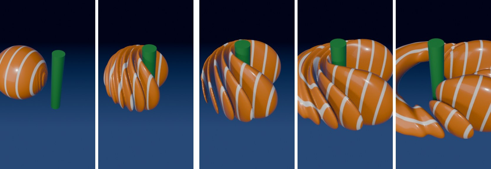

# quantum-scatter

One electron hits a rod it can't pass through. It doesn't bounce off and it doesn't pick a side: the wave splits, flows around both sides at the same time, and wraps into a ring behind the obstacle.

This is a real solution of the Schrödinger equation, rendered in Blender. Nothing is hand-animated.

## Run it

1. Install [Blender](https://www.blender.org/download/) 4.2 or newer (tested on 5.2).
2. File → New → General → **Scripting** tab → Open `rod_scatter_blender.py` → **Run Script**.
3. Wait about 1 minute while the equation is solved (Window → Toggle System Console shows progress).
4. **Render → Render Animation (Ctrl+F12)**. You get one file: `~/OrbitalRenders/rod_scatter/rod_scatter.mp4`.

GPU recommended. Set `ENGINE = "CYCLES"` at the top of the file for a slower, prettier render.

## Settings (top of the file)

| Setting | What it does |
|---|---|
| `SECONDS`, `FPS` | Video length and frame rate (14 s, 30 fps) |
| `K0` | Electron momentum: higher = faster, more stripes |
| `SIGMA` | Size of the wave packet |
| `ROD_R` | Rod radius |
| `ISO` | Surface level: lower = fatter packet, more scattered waves visible |
| `VOX_XY`, `VOX_Z` | Surface resolution: higher = smoother, slower |
| `COL` | Colors |

## The physics

iħ ∂ψ/∂t = −(ħ²/2m) ∇²ψ + V(x,y)ψ, with ħ = m = 1.

The rod is infinite along z, so the 3D wave function splits exactly into ψ(x,y,t) · g(z,t). ψ(x,y,t) is solved on a 320×320 grid with the split-step Fourier method; g(z,t) is a free Gaussian that spreads on its own. The orange surface is the exact 3D isosurface of |ψ|², where the electron is most likely to be found. The white stripes are the phase of the wave, the part a classical ball can't have.

The rod is a smooth wall 60 units high, far above the electron's energy (4.5), so nothing tunnels through it. Everything you see behind the rod is the wave bending around it.

## Why it doesn't crash Blender

No Python runs during playback or render. Each frame of the solution is saved as an EXR image, and Geometry Nodes read the right one for the current frame by themselves.

---

By [@AlexCarten_](https://x.com/AlexCarten_). Style inspired by @paulgsc's animations. MIT license.
